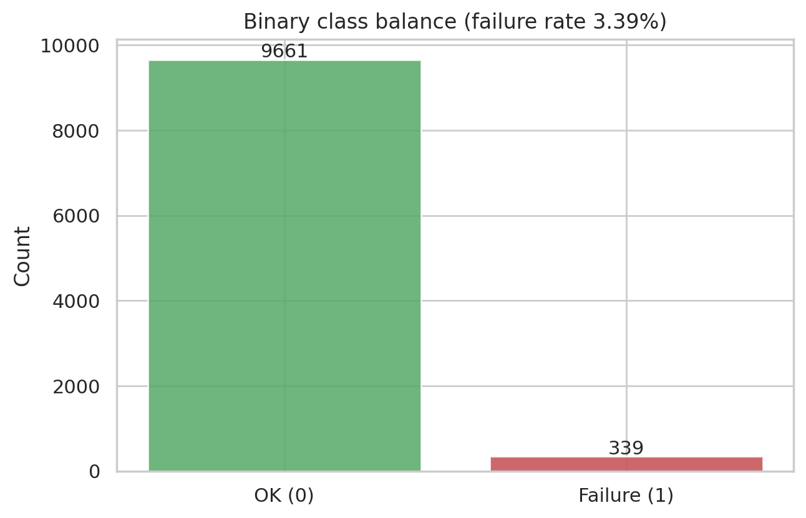
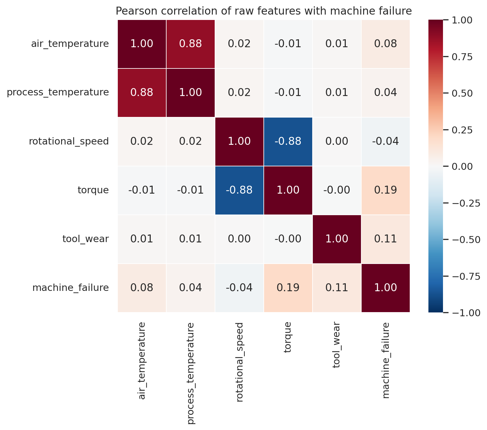
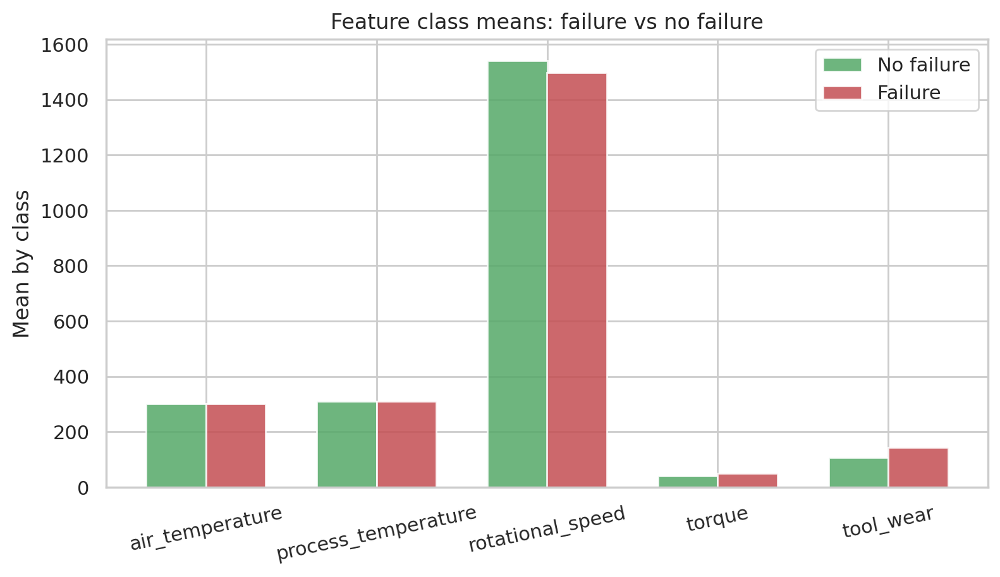
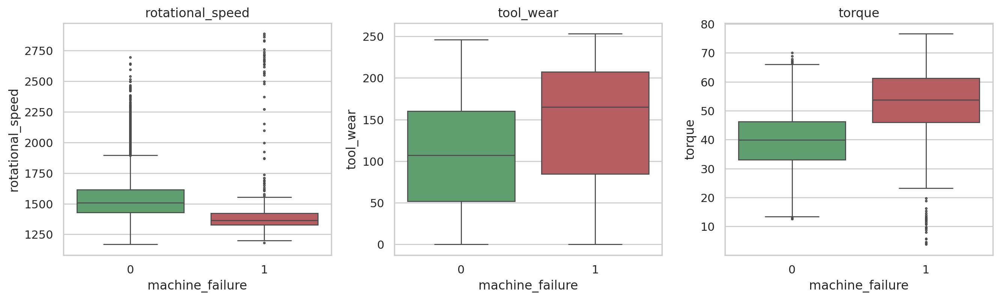
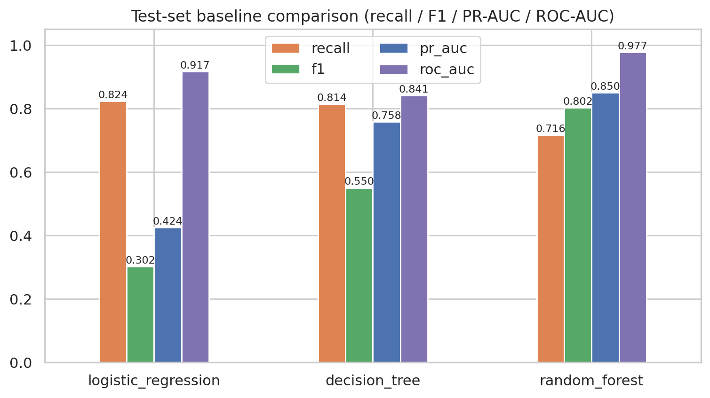
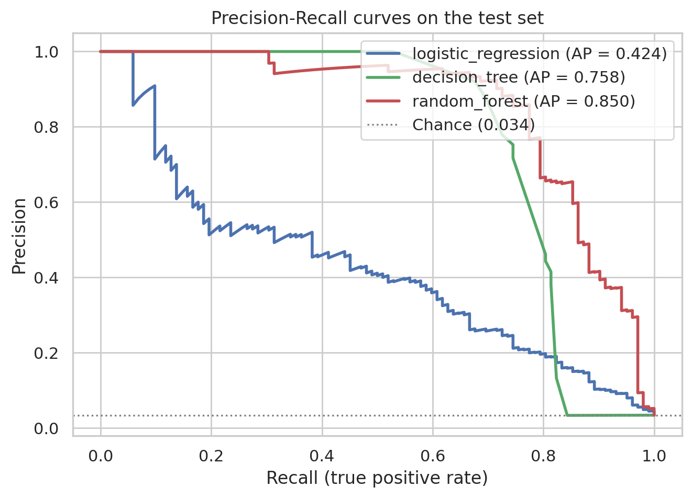
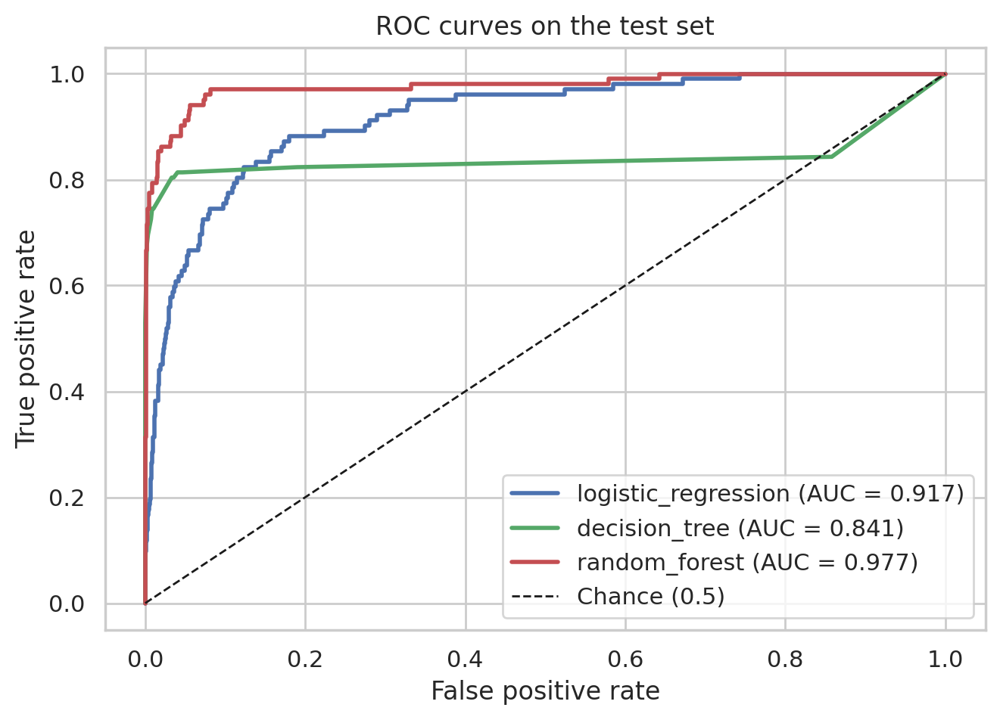
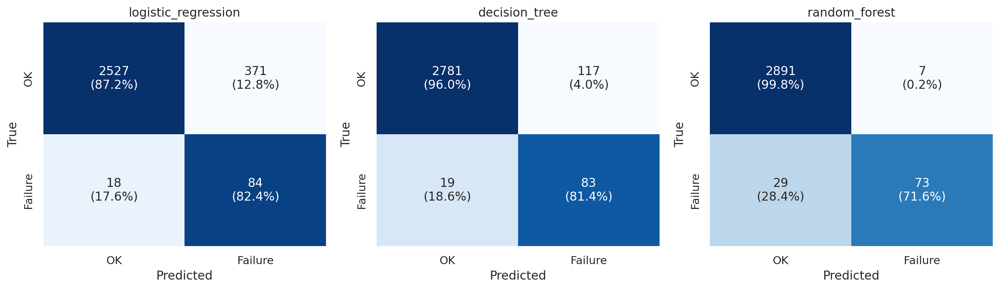
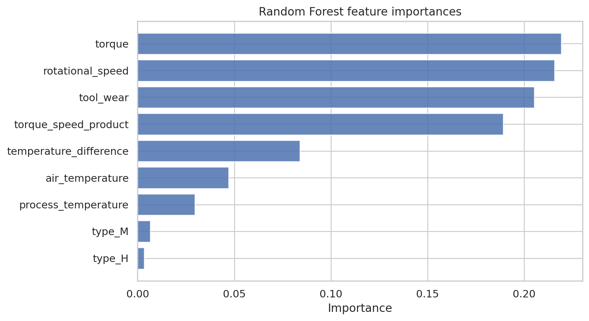

# 摘要

本研究以 UCI AI4I 2020 Predictive Maintenance 資料集為例，建立一套從資料取得與清洗、探索分析、特徵工程、到二元分類基準模型比較的完整流程，目標是預測工具機是否發生失效（`machine_failure`）。資料集共 10,000 筆、16 個欄位，包含 5 個製程感測特徵與 5 個失效模式旗標；前處理時移除 UTF-8 BOM、將原始帶單位與空格的欄位名標準化為 snake_case，並記錄 27 筆失效旗標與主標籤不一致的樣本。探索結果顯示失效比例僅 3.39%（339/10,000），屬嚴重類別不平衡：各失效模式出現次數為 hdf 115、osf 98、pwf 95、twf 46、rnf 19；失效組的工具磨損平均高出 37.09 分鐘、扭矩高出 10.54 Nm、轉速低 43.77 rpm，是區辨力最高的三個特徵。

模型採用三種基準分類器：Logistic Regression、Decision Tree 與 Random Forest，全部以 Pipeline 封裝、以訓練集配適標準化與 one-hot 編碼以防止資料外洩，並以 `class_weight` 處理不平衡；資料以分層抽樣切分為訓練集 7,000 筆、測試集 3,000 筆（70/30，seed = 42）。考慮類別不平衡，評估以 recall、F1、PR-AUC 與 ROC-AUC 為主 —— 隨機森林在 F1（0.7821）、PR-AUC（0.8498）與 ROC-AUC（0.9786）皆為三模型中最佳，但 recall 僅 0.6863，於測試集漏檢 32 台失效機器；Logistic Regression 與 Decision Tree 的 recall 分別為 0.8235 與 0.8333，但精確度低（分別為 0.1846 與 0.4208），誤報數顯著增加。特徵重要度分析一致指出扭矩（torque）、轉速（rotational_speed）與工具磨損（tool_wear）是預測失效的核心訊號。此結果顯示：在維護情境下，模型選擇必須在「召回失效」與「減少誤報」之間做明確權衡，閾值調校與成本敏感決策是後續最直接的方向。

**關鍵詞：** 預測性維護、AI4I 2020、類別不平衡、ROC-AUC、PR-AUC、隨機森林

# 1. 緒論

## 1.1 研究背景與動機

預測性維護（Predictive Maintenance, PdM）是工業 4.0 的核心應用之一：以機台的感測資料預測即將發生的失效，在故障造成停機與安全風險之前排定維護。UCI Machine Learning Repository 的 AI4I 2020 Predictive Maintenance 資料集（Matzka, 2020）以合成資料模擬工具機加工過程中五種失效模式的生成機制，包含空氣／製程溫度、轉速、扭矩與刀具磨損等即時感測值，並標註 `machine_failure` 主標籤與 `twf`、`hdf`、`pwf`、`osf`、`rnf` 五個失效模式旗標，是驗證「感測資料 → 失效預測」端到端流程的良好基準。

與一般的分類任務相比，本資料集有兩個關鍵挑戰：其一是失效樣本極少（3.39%），單純追求準確率會得出「全部預測為正常」的無用模型；其二是在真實維護情境中，漏掉一台即將故障的機台（偽陰性）的代價通常遠高於多派一次技術員（偽陽性），因此模型評估必須以 recall 與 PR-AUC 為主。

## 1.2 研究目的

本研究旨在完成以下工作：

1. 取得 AI4I 2020 原始資料並保存於專案中，完成 BOM 處理與欄位標準化，確保分析可重現。
2. 檢查資料品質（缺失值、重複列、旗標一致性），進行探索分析並確認類別不平衡的程度。
3. 進行特徵工程，並以嚴格的資料外洩防護（排除識別碼與失效模式欄位）建立建模資料。
4. 比較三種基準分類模型（Logistic Regression、Decision Tree、Random Forest），以 recall / F1 / PR-AUC / ROC-AUC 與混淆矩陣評估。
5. 分析特徵重要度，撰寫小論文討論模型表現、指標權衡與維護情境的應用意涵。

# 2. 資料集與前處理

## 2.1 資料來源與欄位說明

原始資料取自 UCI Machine Learning Repository 的 AI4I 2020 資料集（壓縮包內含一個 CSV），由 `scripts/prepare_ai4i.py` 下載並整理後保存為 `data/ai4i2020.csv`。資料共 10,000 筆、16 個欄位，經標準化後欄位如下：

**表 1：AI4I 2020 資料集欄位（標準化後）**

| 欄位 | 類型 | 單位 | 說明 |
|:---|:---|:---:|:---|
| `udi` | 數值 | — | 識別碼，1–10,000 |
| `product_id` | 文字 | — | 產品 ID，格式為品質代碼 L/M/H + 5 位數字 |
| `type` | 類別 | — | 產品品質變異：L（6,000 筆）、M（2,997 筆）、H（1,003 筆） |
| `air_temperature` | 數值 | K | 環境溫度 |
| `process_temperature` | 數值 | K | 製程溫度，恆高於環境溫度 1 K 以上 |
| `rotational_speed` | 數值 | rpm | 主軸轉速 |
| `torque` | 數值 | Nm | 主軸扭矩 |
| `tool_wear` | 數值 | min | 刀具已使用時間（分鐘） |
| `machine_failure` | 0/1 | — | 目標變數：機台是否失效 |
| `twf` / `hdf` / `pwf` / `osf` / `rnf` | 0/1 | — | 五個失效模式旗標：刀具磨損、散熱失效、電源失效、過應力、隨機失效 |

## 2.2 資料品質檢查與前處理

UCI 原始 CSV 以 UTF-8 with BOM 儲存，且欄位名稱為「UDI」「Air temperature [K]」等帶有空格與單位括號的命名。前處理腳本以 `encoding="utf-8-sig"` 讀入以剝除 BOM，並對欄位型別進行驗證（`machine_failure` 與旗標須為 0/1、`type` 須為 L/M/H、`product_id` 須符合 `[LMH]\d{5}` 格式），再重新輸出統一 snake_case 命名的 `data/ai4i2020.csv`。

品質檢查結果如下：

- 資料維度 10,000 × 16，數值與旗標欄位缺失值為 0，重複列為 0。
- 失效模式旗標與主標籤存在不一致：共 **27 筆**。其中 18 筆為 `rnf`（隨機失效）旗標為 1 但 `machine_failure` 為 0（這是該資料集已知的資料生成特性），另 9 筆為 `machine_failure` 為 1 但五個失效旗標皆為 0。這 27 筆的索引已另存於 `data/ai4i2020_flag_inconsistency.csv`；本研究保留這些樣本並以其原始 `machine_failure` 作為建模目標，僅在解讀旗標計數時留意此不一致。

**表 2：目標變數與失效模式分布**

| 類別／模式 | 筆數 | 佔比 |
|:---|:---:|:---:|
| 正常（`machine_failure` = 0） | 9,661 | 96.61% |
| 失效（`machine_failure` = 1） | 339 | 3.39% |
| hdf（散熱失效） | 115 | 1.15% |
| osf（過應力失效） | 98 | 0.98% |
| pwf（電源失效） | 95 | 0.95% |
| twf（刀具磨損失效） | 46 | 0.46% |
| rnf（隨機失效） | 19 | 0.19% |

失效比例僅 3.39%，且各失效模式彼此部分重疊（部分失效樣本同時觸發多個旗標），屬於多元因、極端不平衡的二元分類問題。因此本研究不以 Accuracy 為主指標，改以 recall、F1、PR-AUC 與 ROC-AUC 為評估核心。



# 3. 探索性分析

## 3.1 特徵與失效的相關性

五個製程感測特徵與 `machine_failure` 的 Pearson 相關係數如表 3：扭矩（0.1913）與工具磨損（0.1054）呈正相關、轉速呈負相關（−0.0442），溫度類特徵的線性相關較弱。但線性相關係數未必反映非線性的交互作用（例如高扭矩 × 低轉速的組合），故後續仍以樹模型捕捉這些非線性訊號。

**表 3：特徵與 `machine_failure` 的 Pearson 相關係數**

| 特徵 | 相關係數 |
|:---|:---:|
| `torque` | 0.1913 |
| `tool_wear` | 0.1054 |
| `air_temperature` | 0.0826 |
| `process_temperature` | 0.0359 |
| `rotational_speed` | −0.0442 |



## 3.2 各類別特徵平均與區辨力

表 4 列出正常組與失效組的特徵平均。失效組的工具磨損平均為 143.78 分鐘（正常組 106.69），扭矩平均 50.17 Nm（正常組 39.63），轉速平均 1,496.49 rpm（正常組 1,540.26）。以類別平均差衡量，區辨力依序為：`rotational_speed`（−43.77）＞ `tool_wear`（+37.09）＞ `torque`（+10.54）＞ `air_temperature`（+0.91）＞ `process_temperature`（+0.29）。

**表 4：正常組與失效組的特徵平均**

| 機台狀態 | 環境溫度 (K) | 製程溫度 (K) | 轉速 (rpm) | 扭矩 (Nm) | 工具磨損 (min) |
|:---|:---:|:---:|:---:|:---:|:---:|
| 正常（0） | 299.97 | 310.00 | 1,540.26 | 39.63 | 106.69 |
| 失效（1） | 300.89 | 310.29 | 1,496.49 | 50.17 | 143.78 |





圖 4 的箱形圖顯示失效組的轉速分布整體偏低、扭矩與工具磨損整體偏高，且失效組工具磨損的下限明顯抬升——這與資料集的生成機制一致（例如刀具磨損失效發生於刀具使用 200 分鐘門檻、過應力失效與扭矩 × 轉速乘積門檻相關），說明派生特徵具有物理基礎。

完整探索摘要另存於 `results/ai4i_eda_summary.md`。

# 4. 特徵工程與資料外洩防護

## 4.1 特徵建構

- 派生特徵 1：`torque_speed_product` = 扭矩 × 轉速（Nm × rpm），對應資料集中「功率失效」的生成機制（扭矩 × 轉速超過門檻）。
- 派生特徵 2：`temperature_difference` = 製程溫度 − 環境溫度（K），對應「散熱失效」的生成機制（兩溫差低於門檻）。
- 類別特徵 `type` 採 one-hot 編碼並丟棄第一層（drop first），避免共線。
- 五個數值特徵以 `StandardScaler` 標準化，供 Logistic Regression 使用；樹模型對單調變換不敏感，共用同一 Pipeline 亦無妨。

## 4.2 資料外洩防護

下列欄位刻意排除於模型輸入之外：

1. **`udi` 與 `product_id`**：純識別碼，會造成假性的擬合與記憶，
2. **五個失效模式旗標（`twf`、`hdf`、`pwf`、`osf`、`rnf`）**：失效模式的「定義列」，若作為特徵即等同於使用答案本身，是嚴重的資料外洩（data leakage）。
3. **`machine_failure`**：為預測目標。

最終建模特徵共 8 個：5 個原始數值特徵（含標準化）、2 個派生特徵與 1 個類別特徵。標準化與 one-hot 編碼由 `Pipeline` 中的 `ColumnTransformer` 在訓練集上配適（fit on train only），預測時才套用到測試集，進一步避免測試集資訊滲入前處理。

# 5. 方法

## 5.1 資料切分

以 `train_test_split(test_size=0.30, stratify=y, random_state=42)` 進行分層切分：訓練集 7,000 筆（失效 237 筆、比例 3.386%）、測試集 3,000 筆（失效 102 筆、比例 3.400%），兩組正例比例一致，保證評估的代表性。

## 5.2 三種基準模型

**表 5：模型設定與不平衡處理**

| 模型 | 關鍵超參數 | class_weight |
|:---|:---|:---|
| Logistic Regression | `max_iter=2000` | `balanced`（反比於類別頻率） |
| Decision Tree | `max_depth=6` | `balanced` |
| Random Forest | `n_estimators=400`、`max_depth=10` | `balanced_subsample`（每棵樹自行重加權） |

三個模型皆以 Pipeline 封裝（前處理 → 模型），統一使用隨機種子 42。`class_weight` 的目的在於補償 3.39% 的極端不平衡，讓失效類別在損失函數中獲得較大的權重，避免模型收斂至「全部預測為正常」的平凡解。

## 5.3 評估指標

考量類別不平衡後採用以下指標：

- **Recall（召回率）**：失效機台中被成功偵測的比例，對應維護情境的漏檢成本。
- **Precision**：預測為失效者中真正失效的比例，對應排程維護的誤檢成本。
- **F1**：上兩者的調和平均。
- **PR-AUC（Average Precision）**：不考慮大量簡單陰性樣本的排序品質摘要，在不平衡資料下比 ROC-AUC 更貼近真實表現。
- **ROC-AUC**：整體機率排序能力。
- 混淆矩陣：定位各模型的錯誤型態。

三模型統一以 `>= 0.5` 的預設閾值輸出預測，故結果反映的是「未調校閾值」下的原始能力，這在 3.39% 不平衡下會系統性壓低 recall，是解讀結果的重要前提。

# 6. 實驗結果

## 6.1 模型比較

測試集（3,000 筆，含 102 台失效機台）上的結果如表 6，數據亦存於 `results/ai4i_model_comparison.csv`（完整指標含 precision 及類別 0 的細項則在 `results/ai4i_full_metrics.csv` 與 `results/ai4i_metrics.json`）。

**表 6：三基準模型的測試集比較**

| 模型 | recall | f1 | pr_auc | roc_auc |
|:---|:---:|:---:|:---:|:---:|
| Logistic Regression | 0.8235 | 0.3016 | 0.4242 | 0.9171 |
| Decision Tree | 0.8333 | 0.5592 | 0.7454 | 0.8584 |
| Random Forest | 0.6863 | **0.7821** | **0.8498** | **0.9786** |







Random Forest 在 F1（0.7821）、PR-AUC（0.8498）與 ROC-AUC（0.9786）三項皆為最佳，是三模型中排序品質與綜合表現最好者。但在固定 0.5 閾值下，它的 recall 僅 0.6863，是三者中最低；Logistic Regression recall 最高（0.8235）但 precision 僅 0.1846（f1 0.3016），Decision Tree 則在 recall（0.8333）與 F1（0.5592）之間取得折衷。Precision-Recall 曲線（圖 6）清楚地呈現這種張力：Random Forest 在低 recall 區間維持高 precision，而 Logistic Regression 靠提升 recall 但付出大量誤報。

## 6.2 混淆矩陣

**表 7：測試集混淆矩陣（測試集 3,000 筆：失效 102 筆、正常 2,898 筆）**

| 模型 | TP | FN | FP | TN | recall | precision |
|:---|:---:|:---:|:---:|:---:|:---:|:---:|
| Logistic Regression | 84 | 18 | 371 | 2,527 | 0.8235 | 0.1846 |
| Decision Tree | 85 | 17 | 117 | 2,781 | 0.8333 | 0.4208 |
| Random Forest | 70 | 32 | 7 | 2,891 | 0.6863 | 0.9091 |



三個模型都足以說明在同一閾值與同一資料切分下，「模型選擇」直接變成一個經營決策：

- **Logistic Regression** 漏檢 18 台，但誤報 371 台（Normal 樣本的 precision 僅 0.8720 class-0 recall 對應地大幅下降），等於對 10 倍以上不必要的機台派工。
- **Decision Tree** 漏檢 17 台、誤報 117 台，整體較均衡。
- **Random Forest** 僅誤報 7 台，但漏檢 32 台失效機台 —— 雖然在 F1 與各排序指標上最佳，卻把近三分之一的失效留在了未偵測狀態。

## 6.3 特徵重要度

Random Forest 的不純度基礎特徵重要度如表 8（存於 `results/ai4i_metrics.json`）；置換重要度（permutation importance，10 次重複，於測試集）如表 9（存於 `results/ai4i_permutation_importance.csv`）。

**表 8：Random Forest 特徵重要度（Gini importance）**

| 特徵 | 重要度 |
|:---|:---:|
| `torque` | 0.2212 |
| `rotational_speed` | 0.2204 |
| `tool_wear` | 0.2031 |
| `torque_speed_product` | 0.1820 |
| `temperature_difference` | 0.0860 |
| `air_temperature` | 0.0475 |
| `process_temperature` | 0.0289 |
| `type_L` | 0.0063 |
| `type_M` | 0.0045 |

**表 9：置換重要度（Random Forest，測試集，10 次重複）**

| 特徵 | 重要度平均 | 標準差 |
|:---|:---:|:---:|
| `rotational_speed` | 0.01557 | 0.00137 |
| `torque` | 0.01197 | 0.00087 |
| `temperature_difference` | 0.01123 | 0.00123 |
| `torque_speed_product` | 0.00963 | 0.00043 |
| `tool_wear` | 0.00917 | 0.00147 |
| `air_temperature` | 0.00590 | 0.00056 |
| `type` | 0.00157 | 0.00107 |
| `process_temperature` | −0.00057 | 0.00065 |



兩種重要度雖排序略有出入（Gini 重要度偏向單體特徵、置換重要度偏向樹集合中真正的增量訊號），但結論一致：**扭矩、轉速、工具磨損**是預測失效的三個核心訊號，兩個派生特徵（`torque_speed_product`、`temperature_difference`）也穩定貢獻資訊，而產品品質等級 `type` 幾乎沒有貢獻。置換重要度顯示 `process_temperature` 的納入甚至輕微傷害模型（−0.00057），與其近為零的相關一致。

# 7. 討論

## 7.1 Random Forest 綜合最佳，但「最佳模型」會漏檢

以 F1、PR-AUC、ROC-AUC 衡量，Random Forest 是三組基準中綜合最優（0.7821 / 0.8498 / 0.9786），其 ROC-AUC 高達 0.9786 表示失效與正常樣本的機率排序幾乎完美分離。但在預設 0.5 閾值下，它只召回 68.63%（70/102）的失效機台，漏檢 32 台。這揭示了兩件事：第一，Random Forest 的效能主要來自排序品質，閾值未同步處理時，其能力未完全轉化為維護可用的高 recall；第二，F1 最佳不等於經營上最佳——漏掉的 32 台失效機台才是維護情境的主要風險。

## 7.2 維護情境下的 recall 權衡

在預測性維護中，偽陰性（漏檢即將失效的機台）與偽陽性（誤報正常機台）的成本通常嚴重不對稱：漏檢可能導致非計畫停機、設備損壞甚至安全事件；偽陽性只是多派一次技術員或多留一次備件。本研究的混淆矩陣具體量化了這個權衡：

| 策略 | recall | 營運代價 |
|:---|:---:|:---|
| Logistic Regression（recall 優先） | 0.8235 | 每次定期巡檢需檢查 455 台預警機台，其中僅 84 台真正失效（precision 0.1846） |
| Decision Tree | 0.8333 | 預警機台 202 台，precision 0.4208 |
| Random Forest | 0.6863 | 預警機台僅 77 台，precision 0.9091，但漏掉 32 台失效 |

若誤報成本遠低於漏檢成本（維護情境的典型假設），Logistic Regression 可能比「F1 最佳」的 Random Forest 更合用；反之，若維護資源（技術員時數、停機窗口）是瓶頸，Random Forest 的低誤報更具吸引力。這正是為何本任務的下一個必要步驟是**閾值調校**：在 ROC / PR 曲線上依營運可接受的漏檢率選擇操作點，而不是沿用預設閾值。

## 7.3 核心特徵與失效機制

三條證據鏈——相關性（表 3）、類別平均差（表 4）、與雙重特徵重要度（表 8、9）——一致指向 **torque、tool_wear、rotational_speed** 為預測失效的三個核心特徵；兩個派生特徵也覆蓋了資料集中「功率失效」與「散熱失效」的生成機制。這種穩定性表示模型學到的不只是統計慣性，而是與失效生成機制（刀具磨損門檻、功率超限、溫差過小）相符的因果性訊號，有助於在正式部署前解讀模型的行為。

## 7.4 研究限制

- 失效比例僅 3.39%，測試集僅含 102 筆正例，各指標的抽樣變異相當大；Recall 的單一百分比變動相當於約 1 台機台。
- 固定 0.5 閾值未經調校，三模型的 recall 皆非其能力上限（見圖 6、7 的曲線），比較結論僅適用於此操作點。
- 資料為合成資料，失效事件的生成機制可控；真實機台的漂移、批次效應與感測器雜訊可能改變特徵重要度與模型表現。
- 未做多折交叉驗證或外部驗證集，未系統性搜尋超參數；27 筆旗標不一致未另行處理。
- 未考慮時間序列資訊（資料為橫切面快照），無法做線上增量預測。

# 8. 結論與未來工作

本研究完成了 AI4I 2020 資料集的取得與清洗（BOM 剝除、欄位標準化、27 筆旗標不一致記錄）、探索分析（3.39% 失效不平衡、hdf 115 / osf 98 / pwf 95 / twf 46 / rnf 19 的失效模式分布、轉速 −43.77 rpm / 工具磨損 +37.09 min / 扭矩 +10.54 Nm 的類別平均差）、特徵工程與嚴格的資料外洩防護，以及三種基準模型的分層 70/30 比較，主要結論如下：

1. 三基準模型中，Random Forest 的綜合表現最佳（F1 0.7821、PR-AUC 0.8498、ROC-AUC 0.9786），Logistic Regression 最差（F1 0.3016、PR-AUC 0.4242）。
2. 但在預設閾值下，三模型呈現明確的 recall–precision 權衡：Logistic Regression（recall 0.8235）與 Decision Tree（0.8333）漏檢少但誤報多（FP 371 / 117），Random Forest（recall 0.6863）幾乎不誤報（FP 7）卻漏檢 32 台失效。
3. torque、tool_wear、rotational_speed 是預測失效的核心特徵，與資料集的失效生成機制一致；`type` 幾乎無貢獻。
4. 在維護情境下，「模型選擇」應以漏檢與誤報的營運成本為準，並以閾值調校取代固定 0.5 閾值。

## 未來工作

1. **閾值調校**：在 PR 曲線上定位可接受的漏檢率／誤報率（例如讓 FN ≤ 5 台），報告對應的 precision 與 recall。
2. **不平衡資料抽樣策略**：與 `class_weight` 比較 SMOTE、ADASYN、RandomOverSampling 等重採樣技術。
3. **模型升級**：加入 Gradient Boosting 系列（XGBoost / LightGBM / HistGradientBoosting）作為與本基準的直接比較對象。
4. **校準與成本敏感學習**：以溫度縮放 / Platt scaling 校準機率，讓「預測失效的機率」可直接對應維護決策的風險等級。
5. **驗證穩定性**：加入 5 折分層交叉驗證，並以獨立的重複訓練回報各指標的信心區間。
6. **失效模式的多標籤預測**：以五個失效模式旗標為多標籤任務（處理 27 筆旗標不一致時另行標記），提供「修什麼」而不只是「要不要修」。

# 參考文獻

1. Matzka, S. (2020). Explainable Artificial Intelligence applied to Quality Assurance and Predictive Maintenance in Manufacturing. *Proceedings of the Third World Conference on Smart Manufacturing (SMT 2020)*. （AI4I 2020 資料集之提出論文）
2. Dua, D., & Graff, C. (2019). UCI Machine Learning Repository: AI4I 2020 Predictive Maintenance Dataset. University of California, Irvine.
3. Pedregosa, F., et al. (2011). Scikit-learn: Machine learning in Python. *Journal of Machine Learning Research*, 12, 2825–2830.
4. Saito, T., & Rehmsmeier, M. (2015). The precision-recall plot is more informative than the ROC plot when evaluating binary classifiers on imbalanced datasets. *PLoS ONE*, 10(3), e0118432.
5. He, H., & Garcia, E. A. (2009). Learning from imbalanced data. *IEEE Transactions on Knowledge and Data Engineering*, 21(9), 1263–1284.
6. Breiman, L. (2001). Random forests. *Machine Learning*, 45(1), 5–32.

# 附錄：專案結構與重現方式

```text
26-ai-new-power/
├── data/
│   ├── ai4i2020.zip                      # UCI 原始下載
│   ├── ai4i2020.csv                      # 清理後資料（BOM 剝除與欄位標準化）
│   └── ai4i2020_flag_inconsistency.csv   # 27 筆旗標不一致樣本索引
├── scripts/
│   ├── prepare_ai4i.py                   # 下載、清洗與驗證資料
│   └── run_ai4i_analysis.py              # EDA、特徵工程、模型訓練與評估
├── figures/                              # 視覺化圖表（ai4i_*.png 共 9 張）
├── results/
│   ├── ai4i_eda_summary.md               # 探索分析摘要
│   ├── ai4i_model_comparison.csv         # 三模型 recall / f1 / pr_auc / roc_auc
│   ├── ai4i_full_metrics.csv             # 完整指標（含 precision 與類別 0 細項）
│   ├── ai4i_metrics.json                 # 全部數值結果（含混淆矩陣與重要度）
│   └── ai4i_permutation_importance.csv   # 置換重要度
└── report/
    ├── ai4i_baselines.md                 # 基準比較原始摘要
    └── ai4i2020_prediction_paper.md      # 本論文
```

重現步驟：

```bash
python3 scripts/prepare_ai4i.py
python3 scripts/run_ai4i_analysis.py
```

環境：Python 3.13、pandas、scikit-learn、matplotlib、seaborn、python-markdown。隨機種子固定為 42。論文的 HTML 版本（`report/ai4i2020_prediction_paper.html`）沿用 `report/paper.css`，由 `scripts/md_to_html.py` 轉換產生。
