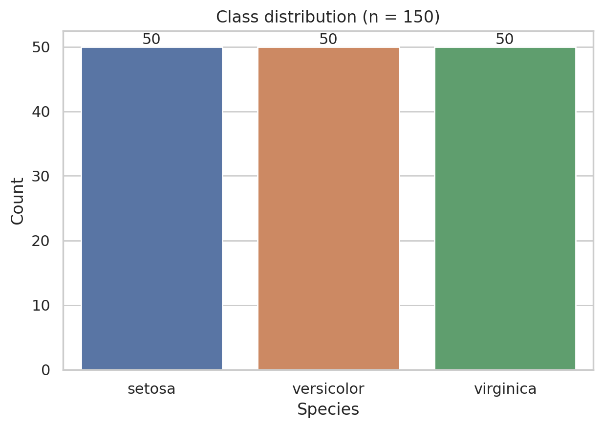
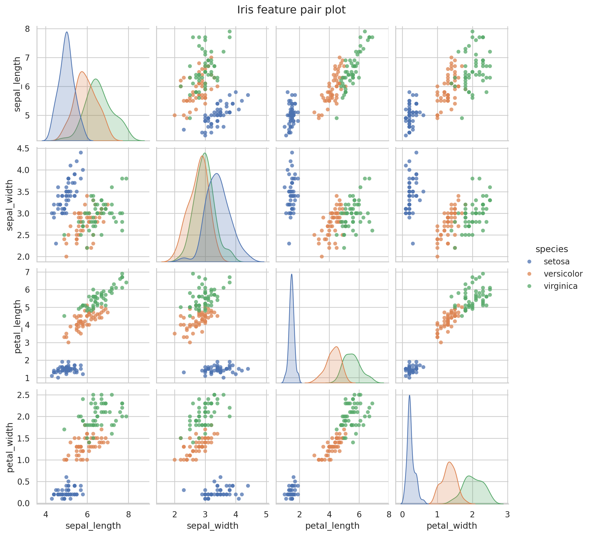
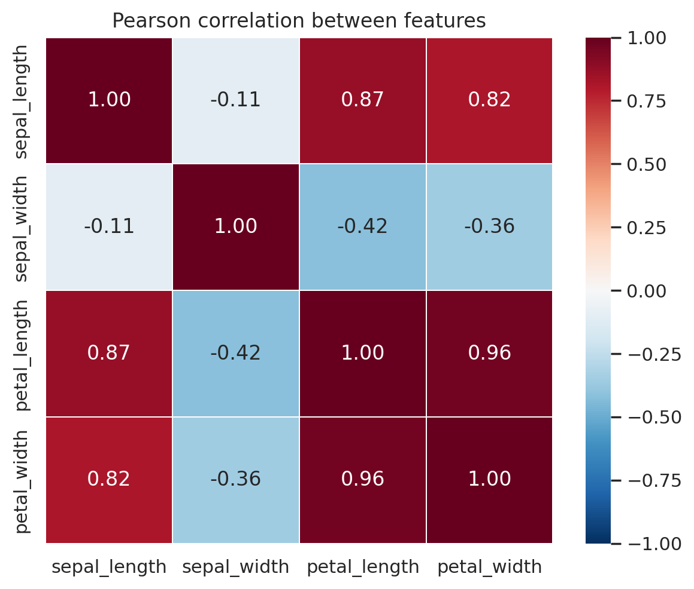
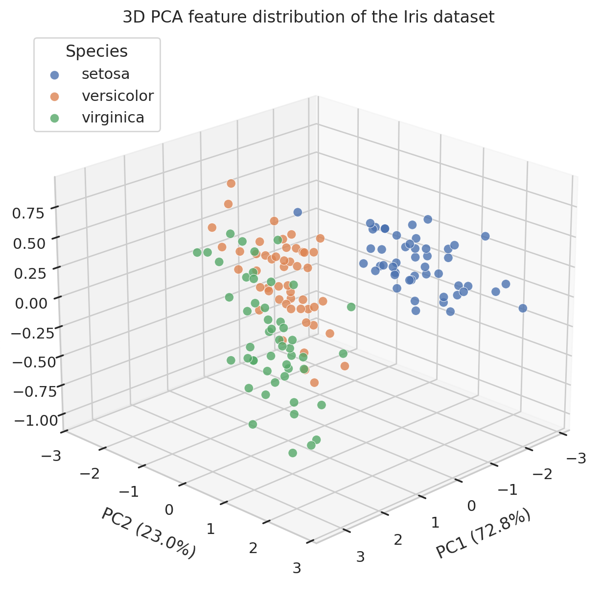
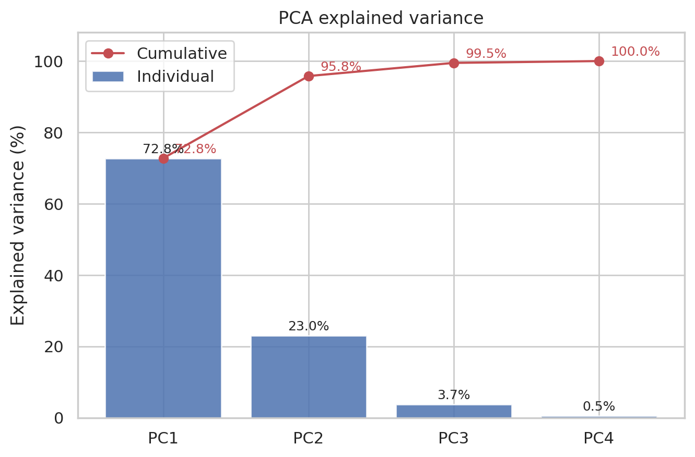
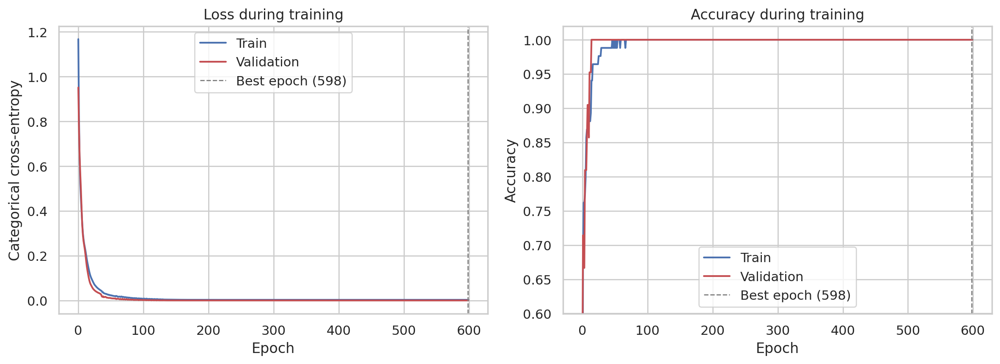
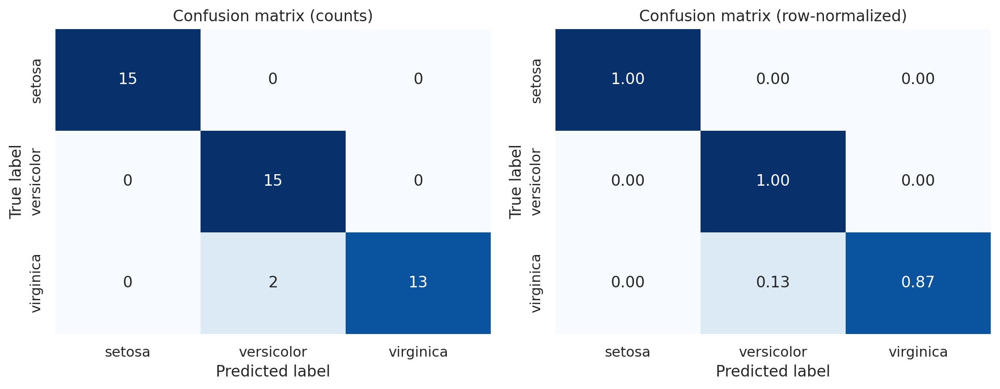
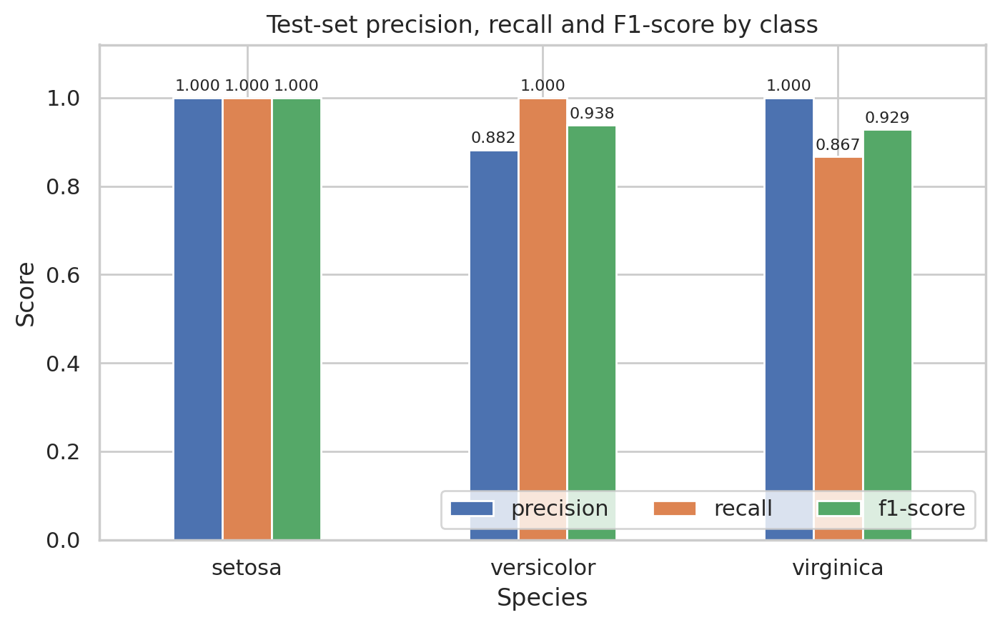
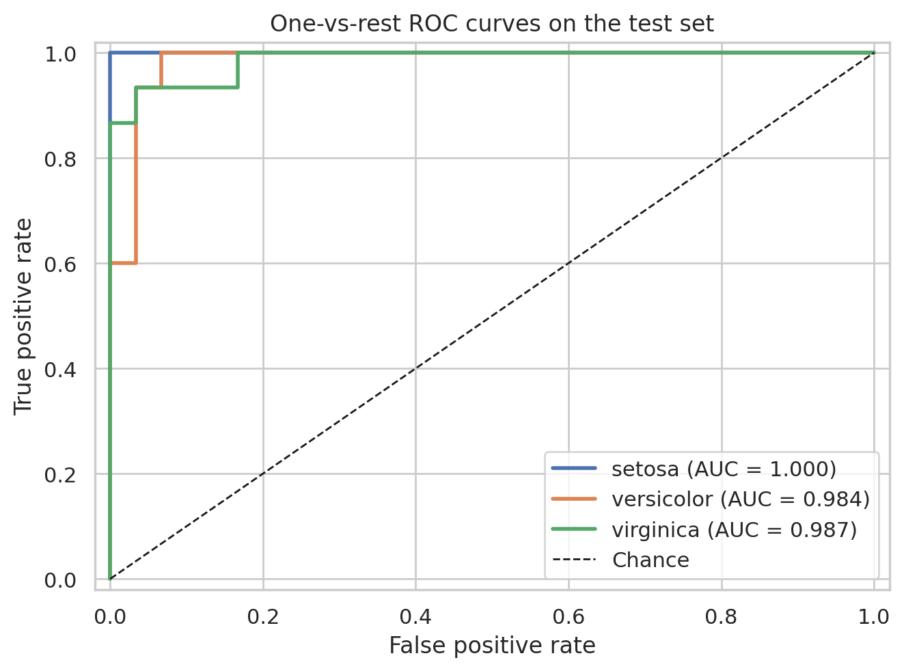
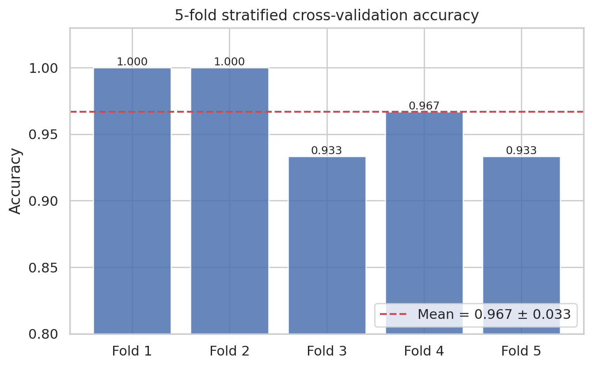

# 摘要

本研究以著名的 Iris（鳶尾花）資料集為例，建立一套從資料取得、探索分析、降維視覺化到類神經網路分類的完整流程。資料集共 150 筆、4 個數值特徵與 3 個物種類別，各類別各有 50 筆，且無缺失值。探索結果顯示，花瓣長度與花瓣寬度具有高度正相關（r = 0.963），且花瓣尺寸在三個物種間呈現明顯差異。以主成分分析（PCA）將四維特徵投影至三維空間後，前三個主成分共解釋 99.48% 的變異量；其中 setosa 與其他兩類可清楚分離，versicolor 與 virginica 則有部分重疊。

分類模型採用 4–16–8–3 的多層感知器（Multilayer Perceptron, MLP），以 70% 資料訓練、30% 資料測試，並在訓練集內部再切出驗證集進行早期停止。測試集結果顯示準確率為 95.56%（43/45）、macro 一對多 ROC AUC 為 0.990；5 折分層交叉驗證準確率為 96.67% ± 3.33%。錯誤分析發現兩筆 virginica 樣本被誤判為 versicolor，其花瓣寬度較小，位於兩類別的邊界區域。整體而言，簡單的三層 MLP 已能在 Iris 資料集上取得良好分類效果，但小型資料集與過度自信的機率輸出仍是後續可改進之處。

**關鍵詞：** Iris 資料集、主成分分析、類神經網路、多層感知器、分類、交叉驗證

# 1. 緒論

## 1.1 研究背景與動機

Iris 資料集由 Fisher（1936）提出，是機器學習與統計分類中最具代表性的基準資料集之一。資料集以萼片（sepal）與花瓣（petal）的長度、寬度描述三種鳶尾花，適合用來驗證資料前處理、降維、分類與模型評估的完整流程。

## 1.2 研究目的

本研究旨在完成以下工作：

1. 取得 Iris 原始資料並保存於專案中，確保分析可重現。
2. 說明資料欄位、特徵與分類，進行基本探索與資料品質檢查。
3. 使用 PCA 繪製三維特徵分布圖，觀察類別的可分性。
4. 建立類神經網路分類模型，完成訓練、測試與視覺化評估。
5. 根據實驗結果撰寫小論文，討論模型表現、錯誤型態與限制。

# 2. 資料集與研究方法

## 2.1 資料來源與欄位說明

原始資料取自 UCI Machine Learning Repository 的 Iris 資料集，並保存為 `data/iris.csv`；原始檔 `data/iris.data` 與欄位說明 `data/iris.names` 亦保留於專案中。資料共 150 筆，欄位如下：

| 欄位 | 類型 | 單位 | 範圍 | 說明 |
|:---|:---|:---:|:---:|:---|
| `sepal_length` | 數值 | cm | 4.3–7.9 | 萼片長度 |
| `sepal_width` | 數值 | cm | 2.0–4.4 | 萼片寬度 |
| `petal_length` | 數值 | cm | 1.0–6.9 | 花瓣長度 |
| `petal_width` | 數值 | cm | 0.1–2.5 | 花瓣寬度 |
| `species` | 類別 | — | 3 類 | 物種：setosa、versicolor、virginica |

四個數值欄位構成模型的輸入特徵（4 維），`species` 為預測目標。三個類別各 50 筆，屬於完全平衡的分類問題。

## 2.2 資料前處理與探索

資料檢查項目包括欄位型態、缺失值、重複列、敘述統計、類別分布、特徵相關性與離群值。數值特徵在輸入模型前以訓練集的平均值與標準差進行標準化（z-score），避免不同尺度造成權重更新不平衡。為避免資料洩漏，標準化參數僅以訓練集估計，再套用至測試集。

探索結果如下：

- 資料維度為 150 × 5，缺失值為 0。
- 共有 3 筆重複特徵列（setosa 2 筆、virginica 1 筆）；由於同一物種內可能出現真實的重複量測，且資料量小，本研究保留這些樣本，未額外刪除。
- 類別分布完全平衡：setosa 50、versicolor 50、virginica 50。
- 依 1.5 × IQR 準則，`sepal_width` 有 4 筆離群值，其餘特徵無離群值；這些數值仍在生物合理範圍內，因此保留。

表 1 為各物種的特徵平均值。可以觀察到 setosa 的花瓣明顯較短且較窄；versicolor 居中；virginica 的花瓣最長、最寬。花瓣特徵比萼片特徵更具鑑別力。

**表 1：各物種特徵平均值（cm）**

| 物種 | 萼片長度 | 萼片寬度 | 花瓣長度 | 花瓣寬度 |
|:---|:---:|:---:|:---:|:---:|
| setosa | 5.006 | 3.418 | 1.464 | 0.244 |
| versicolor | 5.936 | 2.770 | 4.260 | 1.326 |
| virginica | 6.588 | 2.974 | 5.552 | 2.026 |

特徵間的 Pearson 相關係數顯示：花瓣長度與花瓣寬度高度正相關（r = 0.963），萼片長度與花瓣長度亦有高度正相關（0.872）；萼片寬度與花瓣長度則呈中度負相關（−0.421）。這意味著四個特徵存在明顯的共線性與資訊重疊，適合以 PCA 進行降維觀察。







## 2.3 主成分分析（PCA）與三維視覺化

PCA 是一種線性降維方法，透過正交轉換將原始特徵投影到變異量最大的方向上。本研究先將四個特徵標準化，再計算主成分。前四個主成分的解釋變異量分別為：

- PC1：72.77%
- PC2：23.03%
- PC3：3.68%
- PC4：0.52%

前三個主成分累積解釋 99.48% 的變異量，因此以 PC1、PC2、PC3 繪製三維散佈圖，可在大幅降低維度的同時保留幾乎全部資訊。需說明的是，此處 PCA 僅用於探索與視覺化，使用全部樣本配適；分類模型並未使用 PCA 降維後的特徵，以避免任何潛在的資料洩漏。





由圖 4 可見，setosa 形成一個與其他兩類明顯分離的群集；versicolor 與 virginica 在 PC1–PC2 平面上有部分重疊，尤其在邊界區域。這表示前兩個主成分已能捕捉大部分類別結構，但 versicolor 與 virginica 的區分仍需依賴較細微的特徵差異。

## 2.4 類神經網路模型

本研究採用多層感知器（MLP）進行三類分類。模型結構如下：

**表 2：MLP 模型結構**

| 層次 | 類型 | 輸出維度 | 激活函數 | 參數量 |
|:---|:---|:---:|:---:|:---:|
| 輸入層 | 特徵輸入 | 4 | — | 0 |
| 隱藏層 1 | 全連接 | 16 | ReLU | 80 |
| 隱藏層 2 | 全連接 | 8 | ReLU | 136 |
| 輸出層 | 全連接 | 3 | Softmax | 27 |
| **合計** | | | | **243** |

訓練設定如下：

- 損失函數：稀疏類別交叉熵（sparse categorical cross-entropy）。
- 優化器：Adam，初始學習率 0.01；當驗證損失停滯時，學習率以 0.5 倍衰減。
- 批次大小：16；最大訓練週期：600。
- 資料切分：分層抽樣，訓練集 105 筆（70%）、測試集 45 筆（30%），隨機種子 42。
- 驗證策略：由訓練集再切出 20% 作為驗證集，監控驗證損失；EarlyStopping 容忍 50 個週期並還原最佳權重。
- 為降低小型資料集帶來的偶然性，另以 5 折分層交叉驗證評估模型穩定性。

## 2.5 評估指標

模型以測試集準確率、交叉熵損失、各類別 precision / recall / F1-score、混淆矩陣，以及一對多（one-vs-rest）ROC AUC 進行評估。AUC 可衡量模型在不同分類閾值下區分各類別的能力；混淆矩陣則用於定位錯誤型態。

# 3. 實驗結果

## 3.1 訓練過程

圖 6 顯示訓練集與驗證集的損失與準確率變化。模型在前 50 個週期內快速收斂，約在第 100 個週期後訓練與驗證準確率均達到 100%，驗證損失降至極低值。EarlyStopping 最終選擇第 598 個週期的最佳驗證損失權重。

驗證損失在後期仍持續微幅下降，但改善幅度極小，顯示模型已充分擬合訓練資料。訓練損失與驗證損失之間沒有明顯的發散現象，但驗證損失極低（約 0.0005）而測試損失為 0.249，暗示模型對部分測試樣本給出過度自信的錯誤預測，這是後續討論的重點。



## 3.2 測試集分類結果

測試集共 45 筆，模型正確分類 43 筆，準確率為 **95.56%**，交叉熵損失為 **0.2492**。各類別指標如表 3，混淆矩陣如表 4。

**表 3：測試集各類別分類指標**

| 類別 | Precision | Recall | F1-score | 樣本數 |
|:---|:---:|:---:|:---:|:---:|
| setosa | 1.000 | 1.000 | 1.000 | 15 |
| versicolor | 0.882 | 1.000 | 0.938 | 15 |
| virginica | 1.000 | 0.867 | 0.929 | 15 |
| **Macro 平均** | **0.961** | **0.956** | **0.955** | **45** |
| **準確率** | | | **0.956** | **45** |

**表 4：測試集混淆矩陣（列為真實類別、欄為預測類別）**

| 真實 \ 預測 | setosa | versicolor | virginica |
|:---|:---:|:---:|:---:|
| setosa | **15** | 0 | 0 |
| versicolor | 0 | **15** | 0 |
| virginica | 0 | 2 | **13** |

setosa 與 versicolor 在測試集中全數正確；錯誤全部集中在 virginica，共有 2 筆被誤判為 versicolor。由於 versicolor 的 recall 為 1.000，而 precision 為 0.882，表示模型傾向將邊界樣本預測為 versicolor。這與 PCA 圖中 versicolor 與 virginica 重疊的現象一致。





## 3.3 ROC AUC

一對多 ROC 曲線如圖 9。setosa 的 AUC 為 1.000，versicolor 為 0.984，virginica 為 0.987，macro AUC 為 **0.990**。雖然 virginica 有兩筆分類錯誤，但其機率排序能力仍相當好；AUC 接近 1 表示模型對多數樣本能給出正確的相對信心排序。



## 3.4 交叉驗證

為降低單一訓練／測試切分造成的變異，本研究進行 5 折分層交叉驗證。各折準確率如下：

**表 5：5 折分層交叉驗證結果**

| 折次 | 準確率 |
|:---:|:---:|
| 1 | 1.000 |
| 2 | 1.000 |
| 3 | 0.933 |
| 4 | 0.967 |
| 5 | 0.933 |
| **平均** | **0.967 ± 0.033** |

交叉驗證平均準確率為 96.67%，與測試集的 95.56% 接近，顯示模型表現並非單一切分下的偶然結果。各折之間的標準差為 3.33 個百分點，主要來自每折僅有 30 筆驗證樣本，單一錯誤即造成約 3.3% 的變動。



## 3.5 錯誤分析

兩筆誤判樣本如下：

**表 6：誤判樣本**

| 萼片長度 | 萼片寬度 | 花瓣長度 | 花瓣寬度 | 真實類別 | 預測類別 | 預測信心 |
|:---:|:---:|:---:|:---:|:---|:---|:---:|
| 6.3 | 2.8 | 5.1 | 1.5 | virginica | versicolor | 0.9995 |
| 6.1 | 2.6 | 5.6 | 1.4 | virginica | versicolor | 0.9182 |

這兩筆樣本的花瓣長度（5.1、5.6 cm）接近 virginica 的範圍，但花瓣寬度（1.5、1.4 cm）明顯小於 virginica 的平均值 2.026 cm，反而接近 versicolor 的平均值 1.326 cm。模型主要依據花瓣寬度將其判為 versicolor，顯示在特徵邊界上，單一特徵可能主導預測。值得注意的是，模型對第一筆錯誤預測的信心高達 0.9995，這種過度自信會使交叉熵損失明顯上升，即使整體準確率仍高。

# 4. 討論

## 4.1 模型表現

本研究的三層 MLP 在測試集達到 95.56% 準確率，5 折交叉驗證平均 96.67%，與文獻中 Iris 資料集的常見結果（約 95%–98%）相符。setosa 幾近完美分離，主要困難在於 versicolor 與 virginica 的重疊。這與 EDA 和 PCA 的觀察一致：花瓣長度與寬度是區分物種的關鍵特徵，但兩類在邊界區域仍有少數樣本難以僅憑四個形態特徵區分。

## 4.2 為何使用 PCA 但不以其建模

PCA 將四維特徵壓縮至三維，前三個主成分保留 99.48% 變異量，適合視覺化與理解資料結構。然而，PCA 是無監督的線性轉換，其主成分未必與分類邊界對齊；且若以全部資料配適 PCA 再進行模型訓練，可能造成輕微的資訊洩漏。因此本研究僅將 PCA 作為探索工具，分類模型直接使用原始四個特徵，並在訓練集內完成標準化。

## 4.3 過度自信與校準

驗證損失極低但測試損失較高，且錯誤樣本的預測信心接近 1，顯示模型存在過度自信（overconfidence）現象。可能原因包括：

1. 模型容量相對資料量偏大，且訓練週期充足，使訓練與驗證資料幾乎被完全記住。
2. 交叉熵損失會持續獎勵正確樣本的高信心輸出，即使決策邊界附近的樣本仍有不確定性。
3. 測試集僅 45 筆，兩筆高信心錯誤即顯著拉高平均損失。

後續可考慮加入 L2 權重衰減、Dropout、標籤平滑（label smoothing）或溫度縮放（temperature scaling），以改善機率校準，而不必然犧牲準確率。

## 4.4 研究限制

- 資料量小（150 筆），測試集僅 45 筆，單一錯誤即造成約 2.2 個百分點的準確率變動。
- 僅使用單一隨機切分與固定的模型架構，未進行系統性超參數搜尋。
- 資料包含 3 筆重複特徵列；雖未發現標籤衝突，仍可能略微影響評估。
- 特徵僅有四個形態量測，未包含其他生物或環境資訊。
- 交叉驗證雖提升穩定性，但各折訓練資料仍有重疊，不能完全取代獨立外部驗證。

# 5. 結論

本研究完成 Iris 資料集的取得、保存、探索分析、PCA 三維視覺化與類神經網路分類。結果顯示：

1. 四個形態特徵中，花瓣長度與寬度最具鑑別力，且彼此高度相關。
2. 前三個主成分可解釋 99.48% 的變異量；setosa 與其他類別明顯分離，versicolor 與 virginica 有部分重疊。
3. 4–16–8–3 的 MLP 在測試集達到 95.56% 準確率與 0.990 的 macro AUC，5 折交叉驗證平均準確率為 96.67%。
4. 錯誤集中於 virginica 被判為 versicolor 的邊界樣本；模型雖準確，但機率輸出過度自信。

整體而言，簡單的前饋神經網路已足以有效處理 Iris 分類問題。未來可透過正則化、機率校準、超參數搜尋與更大規模的外部資料，進一步提升模型的穩定性與可信度。

# 參考文獻

1. Fisher, R. A. (1936). The use of multiple measurements in taxonomic problems. *Annals of Eugenics*, 7(2), 179–188.
2. Dua, D., & Graff, C. (2019). UCI Machine Learning Repository: Iris Data Set. University of California, Irvine.
3. Pedregosa, F., et al. (2011). Scikit-learn: Machine learning in Python. *Journal of Machine Learning Research*, 12, 2825–2830.
4. Abadi, M., et al. (2016). TensorFlow: A system for large-scale machine learning. *Proceedings of the 12th USENIX Symposium on Operating Systems Design and Implementation*, 265–283.
5. Jolliffe, I. T. (2002). *Principal Component Analysis* (2nd ed.). Springer.
6. Goodfellow, I., Bengio, Y., & Courville, A. (2016). *Deep Learning*. MIT Press.

# 附錄：專案結構與重現方式

```text
26-ai-new-power/
├── data/
│   ├── iris.data          # UCI 原始資料
│   ├── iris.names         # UCI 欄位說明
│   └── iris.csv           # 清理後資料（含欄位名稱）
├── iris_lab/              # 可重複使用的分析模組
│   ├── data.py            # 資料載入、驗證與品質檢查
│   ├── features.py        # 標準化與 PCA
│   └── modeling.py        # 資料切分、MLP 與評估
├── scripts/
│   ├── prepare_iris.py    # 下載與整理資料
│   └── run_analysis.py    # EDA、PCA、模型訓練與評估
├── tests/                 # TDD 測試
│   ├── test_data.py
│   ├── test_features.py
│   ├── test_modeling.py
│   └── test_deliverables.py
├── figures/               # 所有視覺化圖表
├── results/               # 指標、混淆矩陣、訓練歷程與測試紀錄
├── models/
│   └── iris_mlp.keras     # 訓練完成的模型
├── pytest.ini
└── report/
    ├── iris_neural_network_paper.md
    ├── iris_neural_network_paper.html
    └── paper.css
```

本專案的核心模組以測試導向開發（TDD）建置：先撰寫資料契約、PCA、模型架構、切分與評估測試，確認測試失敗後再實作，最後重構分析腳本改用 `iris_lab` 模組。測試涵蓋資料欄位與品質、PCA 變異量、模型參數量、分層切分、標準化無資料洩漏、評估指標與交付檔案完整性。最終測試結果為 32 項全部通過。

重現步驟：

```bash
pytest -q
python3 scripts/prepare_iris.py
python3 scripts/run_analysis.py
```

環境：Python 3.13、NumPy 2.1、pandas 2.2、scikit-learn 1.6、TensorFlow 2.21 / Keras 3.13、Matplotlib 3.10、seaborn 0.13、pytest 8.4。隨機種子固定為 42。主要數值結果另存於 `results/metrics.json` 與 `results/all_results.json`，TDD 紅燈與綠燈紀錄分別為 `results/tdd_red.txt` 與 `results/tdd_green.txt`。
